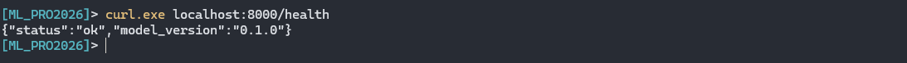
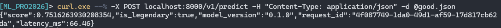
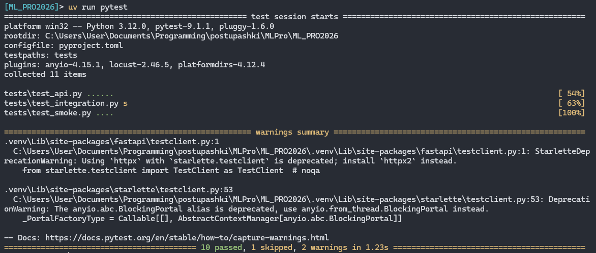
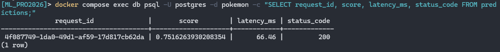
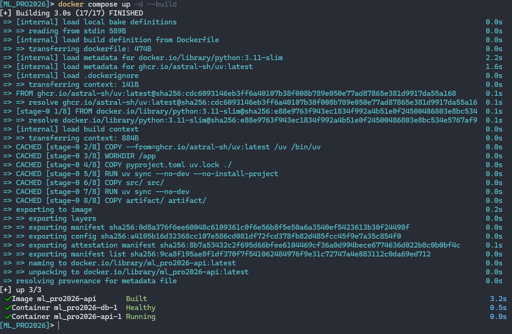
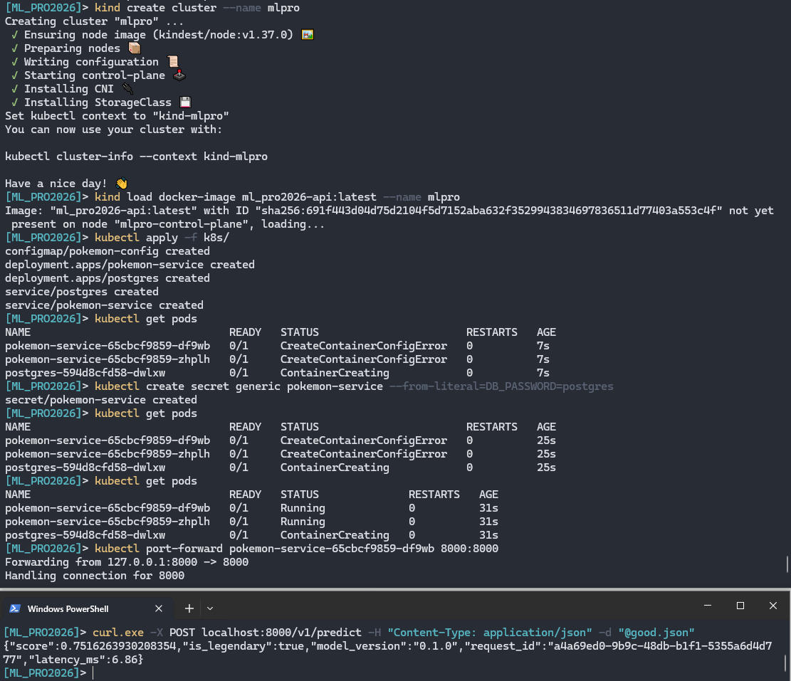
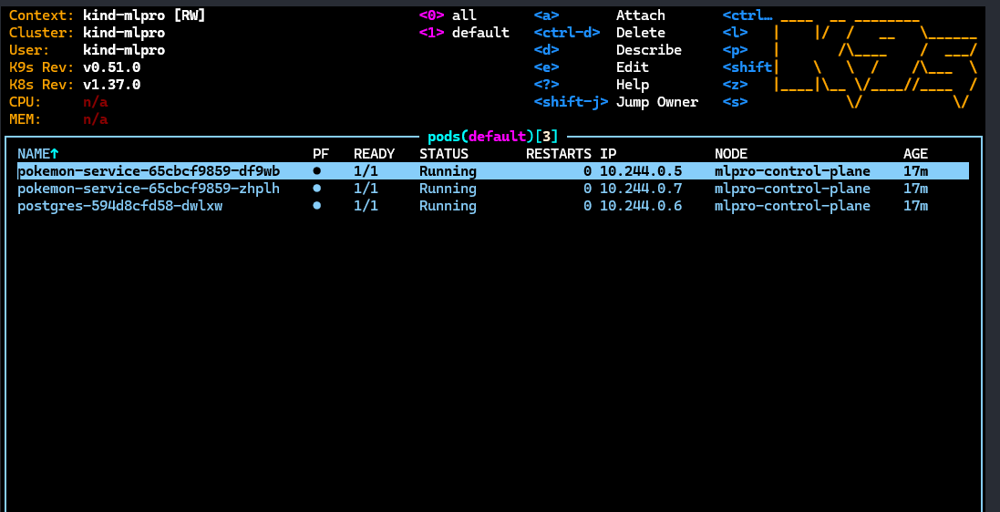
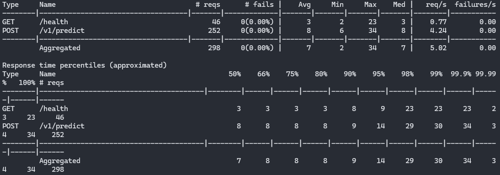
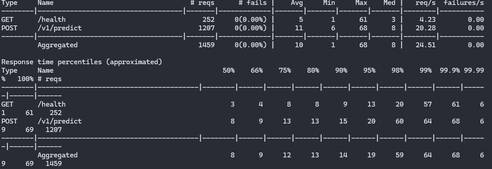
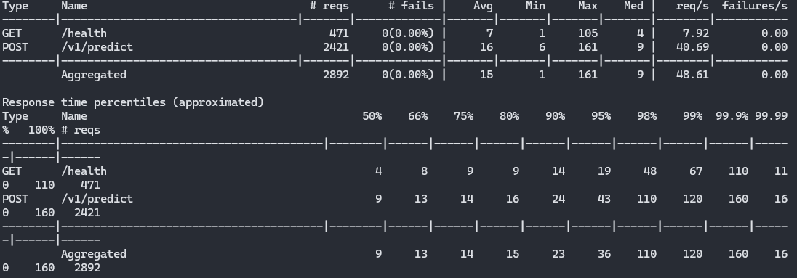

# ML_PRO2026

1. [Базовая часть: Чекпоинты](#1-базовая-часть-чекпоинты)
2. [Нагрузочное тестирование](#2-нагрузочное-тестирование)
3. [Журнал проблем](#3-журнал-проблем)

## 1. Базовая часть: Чекпоинты

### 1.1. Проверка эндпоинтов (Health & Predict)

Проверка работоспособности API через `curl`:

**Health (GET /health):**

**Prediction (POST /v1/predict):**

---

### 1.2. Unit и API тесты (pytest)

Результат запуска тестов, покрывающих контракт (422 ошибки), smoke-тесты и детерминизм:

---

### 1.3. Логи и запись в БД (SELECT)

Подтверждение того, что успешные предикты корректно записываются в таблицу `predictions` в PostgreSQL:

---

### 1.4. Docker Compose

Запуск сервиса через Docker Compose:

---

### 1.5. Kubernetes: Развертывание в Kind

Состояние подов в кластере Kind через `kubectl` и `k9s`, а также вызов `/predict` после `port-forward`

**Kubectl get pods:**

**K9s Interface:**

---

## 2. Нагрузочное тестирование

Для оценки производительности сервиса было проведено нагрузочное тестирование с помощью **Locust** на 
`/v1/predict` и `/health`

### Результаты:

### Прогон 1: 10 пользователей, 5 req/s

**Данные:**
- [run10_stats.csv](./run10_stats.csv) - итоговая статистика
- [run10_stats_history.csv](./run10_stats_history.csv) - история изменения во времени
- [run10_failures.csv](./run10_failures.csv) - упавшие запросы (пусто)
- [run10_exceptions.csv](./run10_exceptions.csv) - исключения (пусто)

### Прогон 2: 50 пользователей, 10 req/s

**Данные:**
- [run50_stats.csv](./run50_stats.csv) - итоговая статистика
- [run50_stats_history.csv](./run50_stats_history.csv) - история изменения во времени
- [run50_failures.csv](./run50_failures.csv) - упавшие запросы (пусто)
- [run50_exceptions.csv](./run50_exceptions.csv) - исключения (пусто)

### Прогон 3: 100 пользователей, 20 req/s

**Данные:**
- [run100_stats.csv](./run100_stats.csv) - итоговая статистика
- [run100_stats_history.csv](./run100_stats_history.csv) - история изменения во времени
- [run100_failures.csv](./run100_failures.csv) - упавшие запросы (пусто)
- [run100_exceptions.csv](./run100_exceptions.csv) - исключения (пусто)

